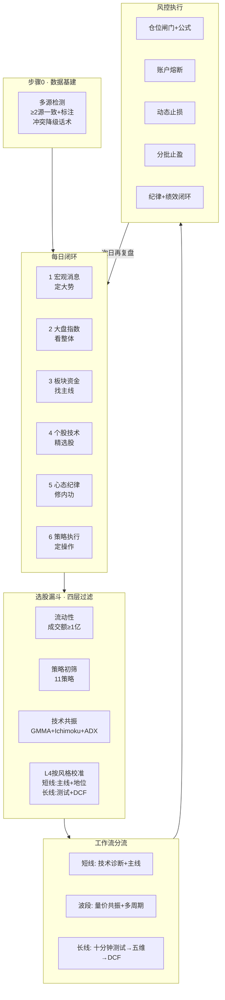

# 00 · 体系总览

## 一张图看懂全流程

## 五模块分工（不可替代点）

| 模块 | 角色 | 不可替代点 |
|------|------|-----------|
| **每日复盘** | 每日复盘与盘前规划 | 六步 SOP + 多源互验 + A股红涨绿跌规范 |
| **批量筛选** | 批量初筛 | 11 策略覆盖最广，AND/OR/SCORE 组合 |
| **技术诊断** | 技术面诊断 | GMMA + 一目均衡 + ADX 共振，S/A/B/C + 动态止损 |
| **市场研判** | 多周期预测与全景 | 多市场、体制感知、大佬圆桌、自上而下 |
| **价值分析** | 长线深度价值 | 护城河 + 财务健康 + DCF + 安全边际 |

## 使用原则

1. **先定大势，再找主线，后精选股**——顺序不可颠倒。
2. **数据可信度先于结论**——关键数字 ≥2 源一致；源不足用降级话术，拒绝硬答。
3. **风格切换看市场，不看心情**——按量能、情绪周期、风险偏好定基调。
4. **买入有清单，卖出有纪律**——计划外不开仓；开仓必须过五条件 + 仓位公式；止损不扛单。
5. **账户熔断优先于一切信号**。
6. **每日 30–90 分钟闭环**，收盘后 1–2 小时内完成复盘。
7. **硬门禁优先**：mode=C 禁买；熔断禁止开仓；交付前 report_lint 必须 PASS（见 09）。
8. **脚本计算仓位与技术分**，禁止手写拍脑袋（scripts/）。

## 触发词对照

| 你要做的事 | 对应模块 |
|-----------|----------|
| 复盘、盘前、资金流、连板 | 每日复盘 |
| GMMA、双趋势、技术诊断、止损位 | 技术诊断 |
| ROE/高股息/低估值/形态批量筛 | 批量筛选 |
| 预测、市场体制、RPS、组合、圆桌 | 市场研判 |
| 护城河、DCF、安全边际、长线 | 价值分析 |
